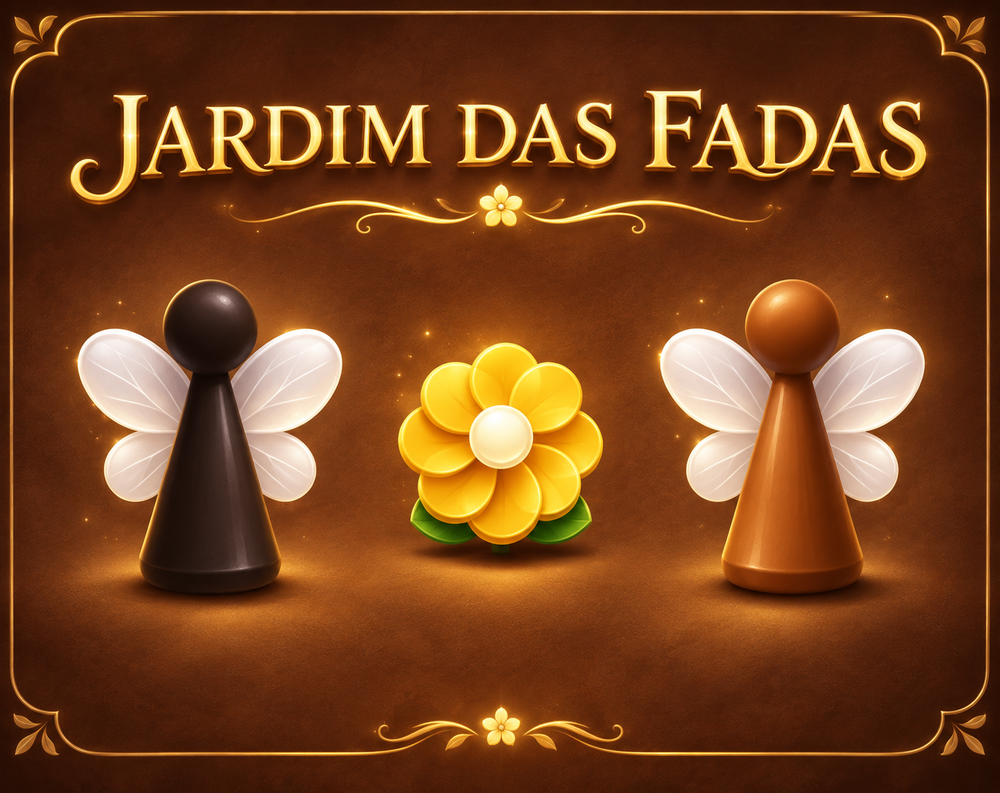

# Jardim das Fadas | Fairy Garden

  

  

A digital strategy board game combining spatial reasoning, tactical movement, pattern building, and resource collection in an enchanted garden.

Developed with **Godot and GDScript** for desktop and mobile web browsers.

## About the Game

Players strategically place flowers, move fairies, collect pollen, and complete objectives to earn victory points.

The game encourages players to adapt their strategies to the evolving garden, balancing immediate rewards with long-term opportunities.

## Key Features

- Competitive matches with 2, 3, or 4 players, including AI opponents
- Dynamic garden board
- Tactical fairy movement
- Flower placement and repositioning
- Rotatable objective cards
- Resource collection and management
- Progressive interactive tutorial
- Adaptive desktop and mobile layouts
- Animated visual and audio feedback
- AI-based tactical decision-making
- Independent game balance simulation tools

## Game Design

The project focuses on creating an accessible strategy game that offers meaningful decisions without overwhelming casual players.

**Core design pillars:**

- Strategic depth
- Spatial reasoning
- Meaningful player choices
- Multiple viable strategies
- Low cognitive load
- Accessible onboarding
- Replayability
- Satisfying game feel

## Game Balance

The project includes an independent Python-based simulation environment designed to investigate competitive balance across different player counts and strategic profiles.

Three strategic approaches are explored:

- **Objective-focused:** prioritizing pattern completion.
- **Collection-focused:** prioritizing pollen collection.
- **Balanced:** adapting decisions to the current board state.

The design goal is to prevent a single strategy from becoming dominant while rewarding situational decision-making.

Historical simulation results support iterative balancing decisions but do not replace playtesting with human players.

## Technologies

| Technology | Purpose |
|---|---|
| Godot 4 | Game engine |
| GDScript | Gameplay systems and AI |
| Python | Balance simulations and automated tests |
| HTML5 / WebAssembly | Web deployment |
| GitHub | Version control |

## Project Architecture

- `scripts/jogo/` — Core gameplay implementation, AI, interface and animation systems.
- `scenes/` — Godot scene configuration.
- `assets/` — Visual and audio resources.
- `simulador/` — Independent game balance simulation tools and historical results.
- `tests/` — Automated checks and validation scripts.
- `documentacao/` — Development history and design decisions.
- `project.godot` — Godot project configuration.

## Development Process

Developed through an iterative, AI-assisted workflow, with emphasis on:

- Board game design
- Digital game adaptation
- Systems design
- Mathematical game balancing
- Rapid prototyping
- Tutorial design
- UI/UX design
- Art direction
- Game feel and game juice
- Mobile optimization
- Iterative testing and refinement

## Running Locally

1. Install Godot 4.
2. Clone or download this repository.
3. Import the `project.godot` file into Godot.
4. Press F6 or F5 to run the game.

The web export uses the Godot Compatibility renderer.

## Project Status

- Genre: Strategy / Digital Board Game
- Engine: Godot 4
- Language: GDScript
- Platforms: Desktop and Mobile Web
- Game language: Brazilian Portuguese

## Documentation

[Portuguese documentation (PT-BR)](LEIA-ME.md)
- Status: Released and under iterative development

---

Independent game development project created as part of a professional Game Design portfolio.
